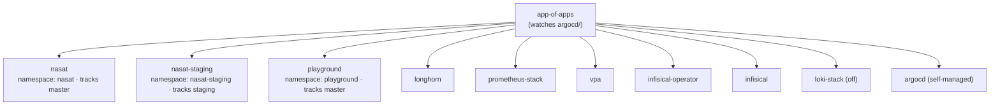

# NASAT


NASAT is two things at once:

1. **A full-stack social app** — Django + DRF backend, React/TypeScript frontend, Postgres, MinIO for media.
2. **A self-hosted GitOps homelab platform** — a two-node K3s cluster run entirely through ArgoCD's app-of-apps pattern, hosting the app itself plus a monitoring stack, Longhorn storage, and a dozen self-hosted "playground" apps (photos, media, notes, automation, DNS, etc.).

## Repository layout

```
nasat/
├── backend/                    Django REST API
│   ├── apps/
│   │   ├── posts/               Posts, feed
│   │   ├── social/               Legacy family-relation model
│   │   └── users/                 Profiles, relations (family/partner/social ties)
│   ├── config/                    Settings, urls, wsgi
│   └── requirements.txt
├── frontend/                    React + TypeScript (Vite)
│   └── src/
│       ├── components/            Cards, sidebar, relations modal, etc.
│       └── pages/                 Profile, Explore, AddUser, EditUser
├── k8s/                          Manifests for the NASAT app itself
│   ├── backend/  frontend/          Deployments + Services
│   ├── ingress/                      Traefik ingress + MinIO ingress
│   ├── minio/  postgres/             Object storage + database
├── argocd/                       ArgoCD Application definitions (the "app-of-apps" tree)
│   ├── app-of-apps.yaml              Root application — watches this folder
│   ├── nasat-master.yaml              → nasat (production, tracks `master`)
│   ├── nasat-staging.yaml             → nasat-staging (tracks `staging`)
│   ├── playground.yaml                → playground (tracks `k8s-playground/`)
│   ├── longhorn.yaml                  → Longhorn storage
│   ├── prometheus-stack.yaml          → kube-prometheus-stack
│   ├── vpa.yaml                       → Vertical Pod Autoscaler (recommend-only)
│   ├── infisical-operator.yaml        → Infisical Kubernetes operator
│   ├── infisical.yaml                 → self-hosted Infisical (secrets manager)
│   ├── loki-stack.yaml                → Loki logging (off, see feature flags)
│   └── argocd-self.yaml               → ArgoCD manages its own install
├── infrastructure/
│   ├── argocd/                        Raw ArgoCD install manifest + ingress + kustomization
│   ├── infisical-operator/            Infisical operator manifests + values
│   ├── longhorn/                       Helm values + storage classes + backup/recurring-job resources
│   ├── monitoring/                     Prometheus + Loki Helm values, Grafana dashboards
│   └── vpa/                            VPA Helm values + the VerticalPodAutoscaler objects
├── infisical/                    Self-hosted Infisical (Deployment, Postgres, Redis, Ingress)
├── terraform/infisical/          Terraform for Infisical projects and machine identities
├── ansible-k3s/                  Playbooks 00–10: node prep, K3s, Tailscale, ArgoCD + Infisical bootstrap
├── k8s-playground/               Self-hosted apps ArgoCD deploys (Gotify, Homepage, Immich) + docs
├── k8s-disabled-apps/            Parked apps no ArgoCD Application watches (n8n, Jellyfin, Paperless, …)
├── .github/workflows/             CI: build/test/push images, auto-bump image tags in git
├── nuke-cluster.ps1              Wipes all Argo-managed workloads (destructive; keeps kube-system etc.)
├── RELATIONS_GUIDE.md            Design notes for the user-relations feature
├── CODE_OF_CONDUCT.md, LICENSE
└── README.md
```

## The application

| Layer | Stack |
|---|---|
| Backend | Django + Django REST Framework, Gunicorn |
| Database | PostgreSQL |
| Media storage | MinIO (S3-compatible) |
| Frontend | React 18 + TypeScript + Vite |
| Core features | Posts with images, a birthdays schedule (Events), and a **relations** system — bidirectional family/partner/social relationship types (mother↔son, wife↔husband, friend↔friend, etc.), surfaced on the profile page and in Explore |

Local dev, API endpoints, and environment variables are unchanged from the standard Django/React workflow — see [Getting started](#getting-started) below.

## Deployment model: one app-of-apps, three environments

Everything in the cluster is owned by a single root ArgoCD `Application` (`argocd/app-of-apps.yaml`), which recursively watches the `argocd/` folder. Every file it finds there becomes its own child `Application`:



- **`nasat`** and **`nasat-staging`** are two live, separate copies of the app — deliberately, so `staging` can be validated before promoting to `master`.
- **`playground`, `longhorn`, `prometheus-stack`, `loki-stack`** are infrastructure — there is intentionally only **one** copy of each. They are not meant to be duplicated the way the app is; there's no useful concept of a "staging Jellyfin."
- Sync is automated (`prune: true`, `selfHeal: true`) everywhere, so the cluster is expected to converge to whatever's in git without manual `kubectl apply`.
- Child applications sync in waves: Longhorn (`-30`), the Infisical operator (`-25`), Prometheus/Grafana (`-20`), Infisical (`-10`), then everything else — the backend/frontend, staging app, VPA, ArgoCD self-management, and playground — in the default wave `0`. ArgoCD waits for each earlier wave to become healthy before starting the next. The operator's `CreateNamespace` option ensures its `infisical` destination exists; the bootstrap prepares `infisical-secrets` before ArgoCD starts.

### Feature flags: parts that are switched off until you want them

Some apps are heavy or not needed on day one. They stay in git but are excluded from what ArgoCD deploys. Each flag is an `exclude:` list with a `# FLAG:` comment. To turn something on, delete its entry and push; ArgoCD deploys it on the next sync.

| Feature | Flag lives in | Currently | To enable |
|---|---|---|---|
| Loki + its Grafana dashboard | `argocd/app-of-apps.yaml` → `directory.exclude` | **off** | remove `loki-stack.yaml` from the list |
| Gotify | `argocd/playground.yaml` → `directory.exclude` | **on** | already on; add `gotify/*` to the list (the commented-out line shows the form) to switch it off |
| Immich | `argocd/playground.yaml` → `directory.exclude` | **off** | remove `immich/*` from the list |

Switching an app that is already running **off** again makes ArgoCD prune it (`prune: true`), including its PersistentVolumeClaims and the data in them. Back up first.

Apps in `k8s-disabled-apps/` are parked differently: no ArgoCD Application watches that folder, so they are not deployed at all. To bring one back, move its folder into `k8s-playground/` (the playground Application recurses) and push.

## Cluster topology (2 nodes)

The cluster has one control-plane node (`master`, about 15 GiB RAM) and one node labeled `node-role.kubernetes.io/worker: worker` (`worker`, about 5.7 GiB RAM). Placement is mixed — only some manifests carry a `nodeSelector`:

| Workload | Placement |
|---|---|
| Longhorn UI, Grafana, VPA recommender, Infisical (+ its Postgres and Redis) | pinned to `master` |
| The nine parked apps in `k8s-disabled-apps/` | pinned to `worker` (selector kept in their manifests) |
| NASAT app (backend, frontend, Postgres, MinIO), Gotify, Homepage, Immich, Prometheus | not pinned — the scheduler decides |

The NASAT app's `nodeSelector` blocks in `k8s/` are commented out; uncomment one (or add your own) to keep a workload on a particular node. Check where things actually run with `kubectl get pods -A -o wide`.

## Infrastructure layer

- **ArgoCD** manages itself (`argocd-self.yaml` → `infrastructure/argocd/`), installed from the standard non-HA `install.yaml` (application controller, repo server, API server, redis, dex, notifications, applicationset — 6 Deployments + 1 StatefulSet).
- **Longhorn** provides the default `StorageClass`. Given a 2-node cluster, `defaultReplicaCount` is set to `1`, and the `longhorn-standard`/`longhorn-critical`/`longhorn-bulk` classes use `numberOfReplicas: 1` (not the usual 3) so volumes can actually satisfy their replica count.
- **Monitoring**: `kube-prometheus-stack` (Prometheus + Grafana, 7-day retention) scrapes the K3s kubelet/cAdvisor and the API server, and evaluates the built-in alert rules; Alertmanager is still off, so nothing notifies yet. `loki-stack` (single-binary mode) is off — see the feature flags. Dashboards are pre-provisioned via Grafana's sidecar (`infrastructure/monitoring/dashboards-configmaps/`).
- **VPA** runs the recommender only (no updater, no admission controller): it publishes request/limit recommendations for the app's workloads but never changes them.
- **Infisical** (self-hosted, `infisical/`) is the secrets manager; its Kubernetes operator (`infrastructure/infisical-operator/`) syncs secrets into the cluster, and `terraform/infisical/` defines the projects and machine identities.
- **Ansible** (`ansible-k3s/`) prepares the nodes, installs K3s and Tailscale, and bootstraps ArgoCD and Infisical.

## k8s-playground: self-hosted apps

Twelve independent apps, each with its own namespace, PVC, Service, and Traefik `Ingress` under `*.nasat.local`. Three live in `k8s-playground/` (Gotify and Homepage are deployed, Immich is excluded); the other nine are parked in `k8s-disabled-apps/`:

| App | What it is | Image | Host | Status |
|---|---|---|---|---|
| **Immich** | Self-hosted photo/video library with ML search | `immich-app/immich-server` + bundled Postgres/Redis | immich.nasat.local | off (excluded) |
| **Jellyfin** | Media server (movies/TV) | `jellyfin/jellyfin` | jellyfin.nasat.local | parked |
| **Paperless-ngx** | Document management + OCR | `paperlessngx/paperless-ngx` + Postgres + Redis | paperless.nasat.local | parked |
| **n8n** | Workflow automation (Zapier-style) | `n8nio/n8n` | n8n.nasat.local | parked |
| **Pi-hole** | Network-wide ad/DNS blocking | `pihole/pihole` | pihole.nasat.local | parked |
| **Trilium** | Hierarchical note-taking | `triliumnext/trilium` | trilium.nasat.local | parked |
| **Wiki** *(namespace: `jspwiki`)* | Team wiki — currently running Wiki.js, not JSPWiki, despite the folder name | `ghcr.io/requarks/wiki` | jspwiki.nasat.local | parked |
| **FreshRSS** | RSS/feed aggregator | `freshrss/freshrss` | freshrss.nasat.local | parked |
| **Gotify** | Self-hosted push notifications | `gotify/server` | gotify.nasat.local | **on** |
| **Uptime Kuma** | Uptime/status monitoring | `louislam/uptime-kuma` | uptime.nasat.local | parked |
| **Linkding** | Bookmark manager | `sissbruecker/linkding` | bookmarks.nasat.local | parked |
| **Homepage** | Dashboard linking to everything above | `gethomepage/homepage` | homepage.nasat.local | **on** |

### Resource budget

Nothing here has infinite headroom (about 15 GiB RAM on the master, about 5.7 GiB on the worker). These numbers are the sum of what's declared in the manifests and Helm values — containers only; the one-off migrate Job and the Kubernetes system pods are not counted:

| | Requested | Limit (burst ceiling) |
|---|---|---|
| NASAT app (backend, frontend, Postgres, MinIO) | ~0.27 CPU / ~0.54 Gi | ~3.55 CPU / ~1.94 Gi |
| Gotify + Homepage (deployed) | ~0.20 CPU / ~0.38 Gi | ~1.0 CPU / ~1.25 Gi |
| Prometheus + Grafana | ~0.30 CPU / ~1.0 Gi | ~1.5 CPU / ~2.25 Gi |
| VPA recommender | 25m / 128Mi | — / 384Mi |
| Immich (excluded) | ~0.40 CPU / ~1.02 Gi | ~2.4 CPU / ~8.4 Gi |
| The 9 parked apps, if all were enabled | ~1.25 CPU / ~2.81 Gi | ~7.7 CPU / ~10.0 Gi |
| Loki (off) | 100m / 256Mi | 500m / 512Mi |

Before turning on more apps, check real usage with `kubectl top nodes` — Immich (ML) and Jellyfin (transcoding) are the apps most likely to actually hit their limits.

## CI/CD

Four GitHub Actions workflow files. The two build pipelines trigger on push to `master` or `staging` (path-filtered so backend/frontend changes don't rebuild each other) and can also be run manually:

- `build-docker-push-bk.yaml` / `build-docker-push-fr.yaml` — install deps, run a smoke test (container must not crash on startup), build and push the Docker image to Docker Hub tagged `:<branch>` and `:<commit-sha>`, then commit the new SHA tag back into `k8s/backend/Backend.yaml` / `k8s/frontend/Frontend.yaml` (`[skip ci]`) so ArgoCD's self-heal picks it up.
- `build-docker-push-all.yaml` — manual `workflow_dispatch` to run both pipelines for a chosen branch on demand.
- `cleanup-old-images.yaml` — weekly image cleanup; currently fully commented out, so it does nothing.

## Getting started

### Prerequisites
- Docker & Docker Compose, Python 3.12, Node.js 20, `kubectl`

### Backend
```bash
cd backend
python -m venv venv && source venv/bin/activate
pip install -r requirements.txt
python manage.py migrate
python manage.py runserver
```

### Frontend
```bash
cd frontend
npm install
npm run dev
```

### Cluster
```bash
# Bootstrap: install ArgoCD *with the repo's kustomize patches*, then hand control
# to the app-of-apps. Easiest: `ansible-playbook playbooks/09-argocd-bootstrap.yaml`
# from ansible-k3s/. The manual equivalent is:
kubectl create namespace argocd
kubectl apply -k infrastructure/argocd --server-side --force-conflicts   # --server-side: the ApplicationSet CRD is too big for client-side apply
# Infisical can't start without its "secret zero" (see infisical/secret.yaml.example):
kubectl create namespace infisical
kubectl apply -f infisical/secret.local.yaml                             # your gitignored copy with real values
kubectl apply -f argocd/app-of-apps.yaml
```

## API Endpoints

### Users
- `GET/POST /api/users/` - List/create users
- `GET/PUT /api/users/{id}/` - Retrieve/update user profile

### Posts
- `GET/POST /api/posts/` - List/create posts
- `GET/DELETE /api/posts/{id}/` - Retrieve/delete post

### Events
- `GET /api/users/birthdays/` - All profiles with a birth date, soonest upcoming birthday first

### Other resources
The router in `backend/config/urls.py` also registers `relations`, `social-links`, `person-aliases`, `life-events`, `devices`, `languages`, `emergency-contacts`, `allergies`, `health-items`, `pets`, `education`, `interests` and `notes` under `/api/`.

## Kubernetes Deployment

### Prerequisites
- K3S cluster running
- kubectl configured
- Docker images pushed to registry

### Deploy with ArgoCD
Deploy the application stack using app-of-apps pattern:
```bash
kubectl apply -f argocd/app-of-apps.yaml
```
Everything else (nasat, nasat-staging, playground, monitoring, longhorn) is reconciled automatically from here — do not `kubectl apply` the individual app manifests directly, or you'll fight ArgoCD's self-heal.

## Contributing

PEP 8 for Python, TypeScript strict mode for the frontend, meaningful commit messages, test locally before pushing.

## License

MIT — see `LICENSE`.

## Support

For issues or questions, please create an issue in the repository or contact the development team.

---

**Last Updated**: Oct 24, 2026
